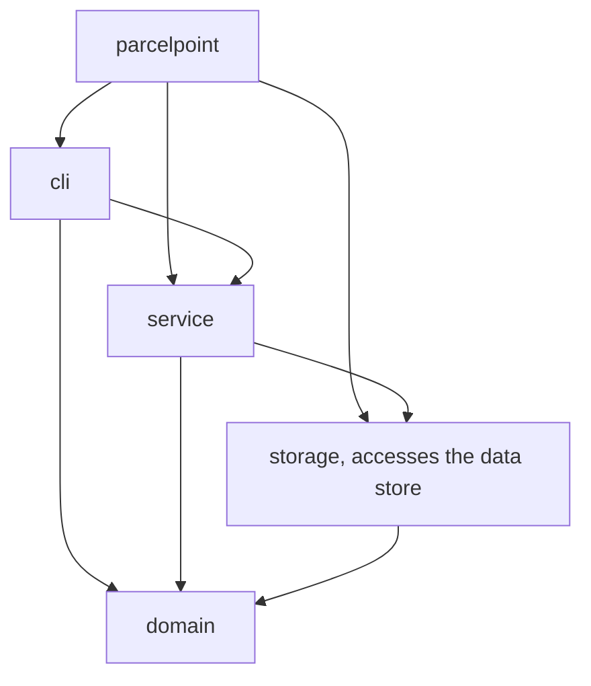
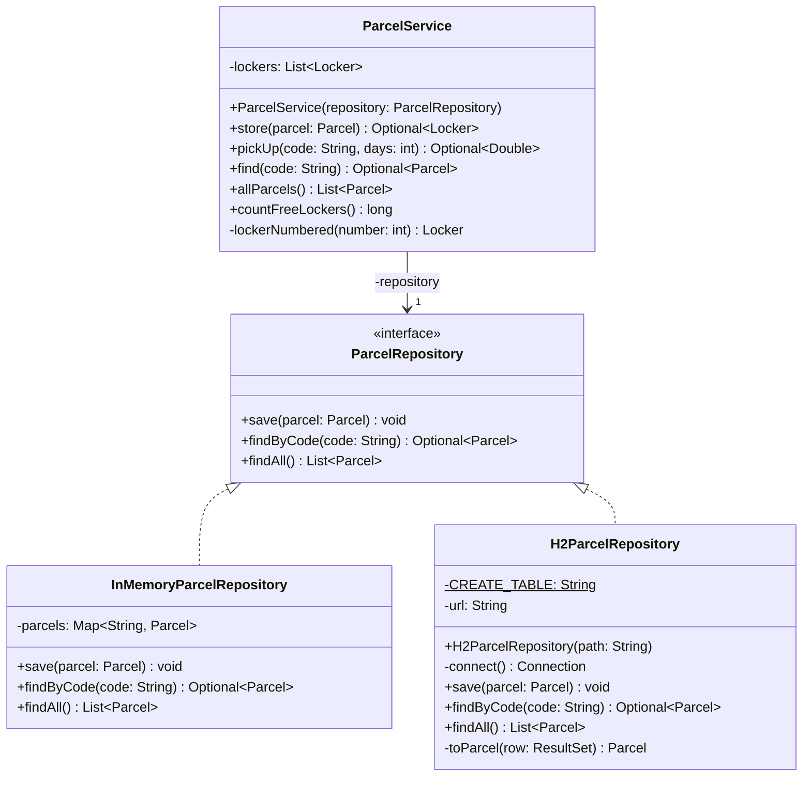
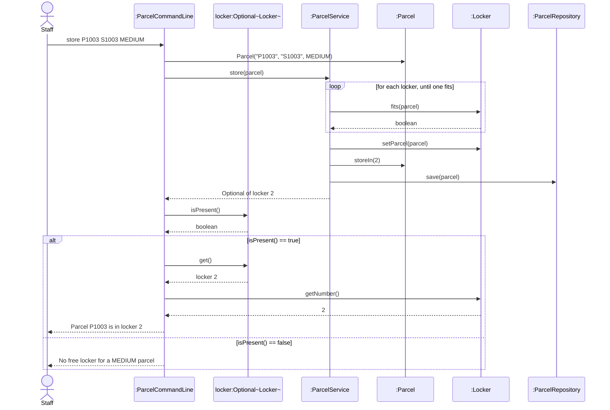

# Lab Report, Designing the Data Management Layer with H2

Repository URL: https://github.com/BuildDBob/itcs382-h2-lab

## Tools

| Item                                     | Version or name                                       |
| ---------------------------------------- | ----------------------------------------------------- |
| JDK                                      | openjdk version "25.0.4.1"                            |
| Maven                                    | Apache Maven 3.10.0                                   |
| IDE                                      | Visual Studio Code 1.145.3 (user setup)               |
| AI tool and exact model, if you used one | Claude (claude.ai), Claude Opus 5.5 (claude-opus-5-5) |

## Part 0. From a store in memory to H2

Commit of the starter, before any change: 4502ef5

0.3 Your prediction for `staff`, written before the second run: no stored parcels, Free lockers: 3

Output of the second run, for `staff` and `quit`:

```text
> staff
Free lockers: 3
> quit
```

State in one sentence where you think the parcels of the first run were kept.

In the map inside InMemoryParcelRepository, which lives in the memory of the running program and is freed when the program ends.

0.5 The line of Main that you would change to keep the parcels somewhere else:

```java
ParcelRepository repository = new InMemoryParcelRepository();
```

0.6 Commit of the switch to H2: 123ccb7

0.7 Output of `SELECT * FROM PARCEL;` after you stored two parcels:

```text
CODE  | STUDENT_ID | PARCEL_SIZE | STATUS | LOCKER_NUMBER
P1001 | S1001      | SMALL       | STORED | 1
P1002 | S1002      | LARGE       | STORED | 3
(2 rows, 13 ms)
```

0.8 Explain why ParcelPoint could not start while the H2 Shell was open, and identify the class that wrote the message `Cannot create the PARCEL table`.

ParcelPoint could not start because the H2 Shell still held the database open, and an embedded database belongs to the program that opened it. H2 locks the file parcelpoint.mv.db, so a second program cannot open it at the same time. The class that wrote the message "Cannot create the PARCEL table" is H2ParcelRepository: its constructor catches the SQLException thrown while connecting and rethrows it as an IllegalStateException with that message.

0.9 Explain why `staff` shows no parcel while `find` shows each one, and why all three lockers look free.

`find` in ParcelService calls `findByCode` on the ParcelRepository interface, implemented by H2ParcelRepository. This method executes `SELECT * FROM PARCEL WHERE CODE = ?` with the input code bound to the placeholder, reads the matching row from the PARCEL table and turns it into a Parcel with `toParcel`. However, `staff` uses `listAll`, which first calls `allParcels`. This calls `findAll`, which is still the starter stub `return List.of();`: with no arguments, List.of() returns an empty list, and no SQL is executed, so no parcel is printed. The lockers look free because the ParcelService constructor fills them from the same `findAll`, putting every waiting parcel back into its locker. It receives the empty list, so all three lockers stay empty and `countFreeLockers` returns 3. The constructor itself is correct; the cause is the stub `findAll`.

0.11 Your findAll method:

```java
    @Override
    public List<Parcel> findAll() {
        String sql = "SELECT * FROM PARCEL ORDER BY CODE";
        List<Parcel> parcels = new ArrayList<>();
        try (Connection connection = connect();
                PreparedStatement statement = connection.prepareStatement(sql);
                ResultSet row = statement.executeQuery()) {
            while (row.next()) {
                parcels.add(toParcel(row));
            }
        } catch (SQLException e) {
            throw new IllegalStateException("Cannot read the parcels", e);
        }
        return parcels;
    }
```

Commit that adds findAll: 5deff1a

0.12 Output of `SELECT * FROM PARCEL;` after the pickup:

```text
CODE  | STUDENT_ID | PARCEL_SIZE | STATUS    | LOCKER_NUMBER
P1001 | S1001      | SMALL       | PICKED_UP | null
P1002 | S1002      | LARGE       | STORED    | 3
(2 rows, 13 ms)
```

0.13 Optional. Describe what `find P9999'OR'1'='1` showed while the SQL was joined from strings, and what it showed after you put the placeholder back.

## Part A. Model the design

A1 Complete the flowchart with one node for each package and one arrow for each dependency, from the package that uses to the package that is used. Mark the package that accesses the data store.



State whether cli depends on storage, and explain why.

No, cli does not depend on storage. ParcelCommandLine imports only classes of domain and service, and no class of storage. It reaches the parcels only through ParcelService, which in turn reaches them only through the ParcelRepository interface, so the user interface layer never touches the data management layer directly.

A2 Complete the class diagram of the data management layer with ParcelService, the interface ParcelRepository with its three operations, and the two classes that implement it.



A3 Draw a sequence diagram for the command `store P1003 S1003 MEDIUM`, from the staff member to the repository. Show each message as an operation of the class that receives it.



Explain why the last lifeline is the interface ParcelRepository rather than H2ParcelRepository.
ParcelService keeps its repository in a field whose type is the interface ParcelRepository, and its code never names H2ParcelRepository, so the message `save` goes to whatever object stands behind the interface. Main decides at run time whether that object is an H2ParcelRepository or an InMemoryParcelRepository. Drawing the interface keeps the diagram true for either store and shows the Dependency Inversion Principle: we can switch databases without changing ParcelService.

## Part B. Design questions

1. Identify the files that you changed to move from the store in memory to H2, and explain why no other class had to change. Use the terms of this course.

Only Main.java was changed: the import line and the line that creates the repository, which now creates `new H2ParcelRepository("./data/parcelpoint")` instead of `new InMemoryParcelRepository()`. This follows the Dependency Inversion Principle. ParcelService depends on the abstraction ParcelRepository, the boundary of the data management layer, and receives the concrete object through its constructor (dependency injection), so it never names a concrete store and no other class had to change. Main is the one place that chooses the store, which gives flexibility in changing databases.

2. The PARCEL table stores the size of a parcel as SMALL, MEDIUM or LARGE rather than as 1, 2 or 3. Identify the type of connascence between ParcelSize and the table in each case, and explain which one is weaker.

With SMALL, MEDIUM, LARGE, it is connascence of name: the table and ParcelSize must agree on the names of the constants, which `name()` and `valueOf` translate. With 1, 2, 3, it is connascence of convention (also called meaning): both sides must agree on what each number stands for, and if the number came from `ordinal()` it would also be connascence of position. Connascence of name is weaker. Changing a meaning or the order of the constants with numbers silently loads the wrong size and fee, while renaming a constant makes `valueOf` throw an error.

3. Project Phase 2 asks for a data store that needs no separate server. Explain why an embedded database such as H2 meets this rule, and describe the limit of an embedded database that Step 0.8 showed.

H2 meets this rule because it runs as a library inside the program's own JVM, the one dependency in pom.xml, so nothing has to be installed or started separately. The table is created on the first run with `CREATE TABLE IF NOT EXISTS`, and the data is kept in a file. The limit is that the process that opens the database locks the file; while the H2 Shell had it open, ParcelPoint could not start, so only one process can use it at a time.

4. State the data store that you would choose for your Project Phase 2 team, files or an embedded database, the requirement that drives the choice, and the package that will access it.

We will use the embedded database H2. The driving requirement is that some of the logic selects records by criteria, such as the science plans of one creator with given statuses, which a SQL `WHERE` clause can easily do, whereas files would need to be loaded, filtered in Java and rewritten each time. The package persistence will access the data store, as the only package that uses the H2 library; its classes implement the repository interfaces that the service package depends on.

## AI usage declaration

| AI tool and exact model                               | Date       | Purpose                                                                           | Files or answers it produced or changed                              | How you checked its output                                                                                                                                            |
| ----------------------------------------------------- | ---------- | --------------------------------------------------------------------------------- | -------------------------------------------------------------------- | --------------------------------------------------------------------------------------------------------------------------------------------------------------------- |
| Claude (claude.ai), Claude Opus 5.5 (claude-opus-5-5) | 2026-11-13 | Read the lab sheet and starter; listed deliverables and common mistakes           | None                                                                 | Compared its summary with the lab sheet                                                                                                                               |
| Claude (claude.ai), Claude Opus 5.5 (claude-opus-5-5) | 2026-11-14 | Explain why `staff` was empty and review my draft of 0.9                          | LAB_REPORT.md 0.9                                                    | Traced listAll, allParcels and the ParcelService constructor to the stub findAll in the code; after writing findAll, `staff` listed both parcels with Free lockers: 1 |
| Claude (claude.ai), Claude Opus 5.5 (claude-opus-5-5) | 2026-11-14 | Correct my draft of findAll                                                       | H2ParcelRepository.findAll; LAB_REPORT.md 0.11                       | Built with mvn package and ran `staff`; both parcels and their lockers appeared                                                                                       |
| Claude (claude.ai), Claude Opus 5.5 (claude-opus-5-5) | 2026-11-14 | Review my A1 package diagram and answer the cli to storage question               | LAB_REPORT.md A1                                                     | Checked every arrow against the import lines of each Java file; rendered on mermaid.live                                                                              |
| Claude (claude.ai), Claude Opus 5.5 (claude-opus-5-5) | 2026-11-14 | Produce the A2 class diagram                                                      | LAB_REPORT.md A2                                                     | Checked each member and visibility against the Java source; rendered on mermaid.live                                                                                  |
| Claude (claude.ai), Claude Opus 5.5 (claude-opus-5-5) | 2026-11-14 | Produce the A3 sequence diagram with the isPresent check, and the answer under it | LAB_REPORT.md A3                                                     | Matched each message to ParcelCommandLine.store and ParcelService.store; rendered on mermaid.live                                                                     |
| Claude (claude.ai), Claude Opus 5.5 (claude-opus-5-5) | 2026-11-14 | Review the whole report, correct errors and fill this table                       | LAB_REPORT.md 0.3, 0.8, 0.9, 0.11, A1, A3, Part B, Tools, this table | Read every change against the code and the lab sheet before committing                                                                                                |
